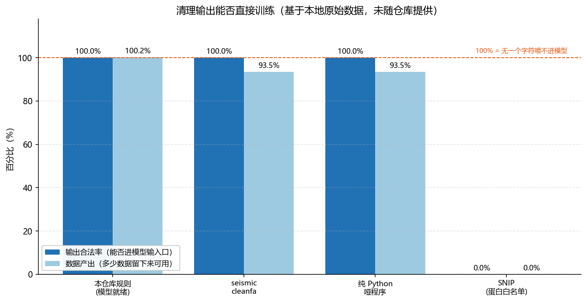

# semantic-seq-curator

把生物序列清洗成**能直接进语言模型输入口**的数据：输出保证只含目标字母表内的字符，
并把每个非标准字符的"原来是什么 → 变成什么 → 为什么"逐条记录下来。

> **这个仓库是什么**：一个做完了、验证过、但不打算继续投入的**原型**。
> **它不是什么**：不是新工具。请先读下面的"诚实定位"，再决定要不要用。

---

## 诚实定位（先说这个）

**核心功能是重复造轮子。** "把非标准字符映射进固定字母表"这件事，已有实现包括但不限于：

- `seqkit replace -p '[^ACGT]' -r N`（一行命令）
- Biopython `SeqIO` + 一张转换表（十几行）
- **seismic cleanfa** 已经做了 IUPAC 模糊码 → N
- 几乎每个 ML 数据管线都自带一个几十行的 normalize 函数

本仓库的核心逻辑量级也在这个水平。所以：**如果你的需求只是"把乱码换成 N"，直接用上面任何一个，不要用这个仓库。**

那这个仓库为什么还存在？只有一个理由：

> **它记录了"如何用实证方法确定一个未知的数据格式约定"，以及一个真实的踩坑教训。**

具体是下面这件事。

---

## 唯一可能有点价值的部分：如何判定 `*[k]*` 的含义

有些上游工具会把无法处理的碱基替换成 `*[k]*` 这样的占位标记。问题是：

- 如果 **k = 丢失了 k 个碱基**（计数）→ 应该还原成 `k` 个 `N`，长度回到真实值，才能训练；
- 如果 **k = 第 k 号标记**（编号）→ 标记只是注解，长度不该变。

**光看数据本身判断不了。** 而且这里有一个很隐蔽的陷阱：

我最初用一个看起来很有力的判据——同一行的**结构注释列**里，该位置的 `~` 个数恰好等于标记的文本宽度
（`*[19]*` 宽 6 字符，那里正好 6 个 `~`），于是误判为"长度就是标记宽度、不该展开"。

**这个判据是循环证据**：结构注释列是从**已经损坏**的序列算出来的，它反映的是损坏后的状态，
不能用来推断损坏前有多少碱基。

**正确做法**：找一个**未被污染**的参照列（例如同一位点的原始序列提取结果），
取占位符两侧各 15bp 作锚点，在参照列里定位，量出两锚点之间的**真实跨度**。

[`verify_placeholder_semantics.py`](verify_placeholder_semantics.py) 就是这个方法的可复用实现：

```bash
# 仓库里带了一个**合成**样例，可直接跑通看效果（不涉及任何真实数据）
python verify_placeholder_semantics.py examples/placeholder_anchor_demo.csv \
    --seq-col seq_with_placeholder --ref-col reference_sequence --flank 15
# → 真实跨度 == k : 3/3 = 100.00%
# → 真实跨度 == 标记宽度 : 3/3 = 0.00%

# 用你自己的数据
python verify_placeholder_semantics.py <raw.csv> \
    --seq-col Sequence --ref-col FASTA_sequence --flank 15
```

它输出"真实跨度 == k"与"真实跨度 == 标记宽度"两个比例，直接给出结论。

在一份本地原始数据上跑出来的结果：**真实跨度 == k 的比例为 100%，== 标记宽度为 0%**
（2168 个可锚定样本；`--flank 10` 时因锚点太短误匹配出现 3/2967 偏差，加长到 15 即消除——
这也是一个值得记住的教训：**锚点必须足够长，否则会匹配到错误位置**）。

结论：`*[k]*` 应还原为 `k` 个 `N`。这个结论**只对该数据集成立**，不要当成通用规律——
换一份数据，请重新跑一次上面的脚本。

---

## 目标字母表驱动的清理

如果确认了约定，清理本身很简单。工具强制的是：**先声明词表，再保证输出 100% 合法。**

```bash
python curate.py <sequences.csv>                        # 自动检测序列列
python curate.py <sequences.csv> --alphabet rna          # 指定模型词表
python curate.py <sequences.csv> --align-col Structure   # 同步还原对齐的注释列
python curate.py <sequences.csv> --gaps drop             # 删除 gap 而非映射为 N
```

内置字母表：

| 档案 | 允许字符 |
|---|---|
| `dna` | A C G T N |
| `rna` | A C G U N |
| `nucleic-mixed` | A C G T U N |
| `dna-iupac` / `rna-iupac` | 标准碱基 + 全部 IUPAC 模糊码 + N |
| `protein` | 20 种标准氨基酸 + X |
| `protein-extended` | 20 + X + B Z J U O * |
| `auto`（默认） | 按每行推断的类型自动选择 |

映射规则：

| 输入 | 处理 |
|---|---|
| 小写 `acgu` | → 大写 |
| IUPAC 模糊码 `R Y W S K M …` | → `N`（严格字母表下）；`-iupac` 档案则原样保留 |
| gap `-` `.` | → `N`（默认，保持对齐）或 `--gaps drop` |
| 占位符 `*[k]*` | → `k` 个 `N`（前提是你已按上面的方法确认了 k 的含义） |
| 其它未知字符 | → `N`/`X`（默认）或 `--unknown drop` |

**必须说清楚**：严格字母表下把 IUPAC 模糊码映射为 `N`，**与 seismic cleanfa 的选择完全相同**——
对固定词表而言这是唯一正确的做法。所以这一点**不构成本仓库的任何优势**。
本仓库相对 cleanfa 的实际差别只有三点：① 输出保证 100% 合法并有独立复核脚本；
② 占位符按计数还原，把 cleanfa 会丢弃的长度补回来；③ 映射逐条记录、字母表可切换。

---

## 结果

下图基于一份**本地原始数据**（未随仓库提供）生成。你可用自己的数据复现：

```bash
python benchmark_model_ready.py <raw.csv> --seq-col Sequence --chart benchmark/model_ready.png
```



| 方法 | 输出合法率 | 数据产出 | 序列保留 |
|---|---|---|---|
| 本仓库规则 | 100.00% | 100.2% | 全部 |
| seismic cleanfa | 100.00% | 93.5% | 全部 |
| 纯 Python 哑程序 | 100.00% | 93.5% | 全部 |
| SNIP（蛋白白名单） | — | — | **0** |

- **合法率**：输出字符 ∈ 目标字母表 的比例。<100% 就意味着有字符喂不进模型。
- **数据产出**：输出字符数 / 原始字符数。本仓库 >100% 是因为占位符被还原为缺失的碱基。
- SNIP 是蛋白工具（白名单仅 20 种氨基酸），用在核酸数据上会整条删光——**这提醒我们：工具用错域会静默清零数据。**

另一张图（[benchmark/comparison.png](benchmark/comparison.png)）是在**合成用例**上对
语义判断正确性的对比，与真实数据无关。

---

## 快速开始

```bash
# 1) 清理（保证输出 100% 在目标字母表内）
python curate.py <sequences.csv> --out cleaned_output

# 2) 独立复核（故意不复用清理代码，重新读一遍成品逐字符检查）
python validate_model_ready.py cleaned_output/cleaned.csv --align-col rna_seq=structure_curated

# 3) 确认未知占位约定的含义（换数据先跑这个；仓库自带合成样例）
python verify_placeholder_semantics.py examples/placeholder_anchor_demo.csv \
    --seq-col seq_with_placeholder --ref-col reference_sequence --flank 15

# 4) 自检
python test_curate_entry.py    # 入口回归（含"全表无字母表外字符"断言）
python test_agent.py           # Agent 组件回归
python run_demo.py             # 合成用例：同一字符在不同上下文得到不同决策
```

依赖：仅标准库。画图需要 `matplotlib`（可选）。

### 作为库使用

```python
from curate import clean_sequence
cleaned, mapping, seq_type, alphabet = clean_sequence("ACGTNacgt-*[ 2]*", alphabet="dna")
# cleaned = "ACGTNACGTNNN"     ← 每个字符都是合法 token
# mapping = {"小写→大写": 4, "gap→fallback": 1, "占位符→fallback×k": 1}
```

---

## 目录结构

```
curate.py                      清理主入口（字母表驱动 + 100% 合法性保证）
validate_model_ready.py        独立复核产物合法性
verify_placeholder_semantics.py 实证未知占位约定的含义（本仓库最有用的一段）
benchmark_model_ready.py       合法率 / 数据产出 对比 + 画图
benchmark.py                   合成用例上的语义判断对比
draw_chart.py                  画上面对比的图
semantic_seq_curator/          可选增强层：IUPAC 知识表、工具注册表、Reasoner、ReAct 循环
                                （注意：这一层是架构脚手架，不是本仓库的卖点）
test_curate_entry.py           入口回归测试
test_agent.py                  Agent 组件回归测试
run_demo.py                    合成用例演示
docs/RESEARCH.md               竞品调研（9 个工具的实际行为核实，含链接）
docs/COMPETITIVE_ADVANTAGE.md  竞品共性 vs 本仓库差异（含"哪些不算差异"的说明）
docs/SKILL.md                  以 DSH Skill 形式描述同一套流程
docs/AGENT.md                  Agent 顶层提示词（System Prompt）
examples/mixed_case.fasta      合成测试序列
examples/example_sequences.csv 合成多列 CSV（可直接跑 curate.py）
examples/placeholder_anchor_demo.csv 占位符锚定方法的合成演示样例
benchmark/                     对比结果 JSON 与图
```

---

## 相关工具（本仓库与它们重叠，优先用它们）

| 工具 | 做什么 | 链接 |
|---|---|---|
| seqkit | 序列工具集，`replace`/`seq` 子命令可直接做字母表规范化 | [shenwei356/seqkit](https://github.com/shenwei356/seqkit) |
| seismic cleanfa | FASTA 规范：模糊码 → N | [rouskinlab/seismic-rna](https://github.com/rouskinlab/seismic-rna) |
| Biopython | `SeqIO` / `Seq` 基础读写与转换 | [biopython/biopython](https://github.com/biopython/biopython) |
| ShortRead (Bioconductor) | 短读过滤，含 `clean()` 移除含模糊碱基的读 | [Bioconductor/ShortRead](https://github.com/Bioconductor/ShortRead) |
| SNIP | 按 20 种标准氨基酸白名单整条剔除序列 | [BBCMdP/SNIP](https://github.com/BBCMdP/SNIP) |
| bio-rs | 逐位符号级校验与 tokenization | [bio-rs/bio-rs](https://github.com/bio-rs/bio-rs) |
| data-labelling | agentic 元数据标注（rationale + confidence + review_queue） | [nextflow-io/nextflow](https://github.com/nextflow-io/nextflow/tree/master/examples/agents/14_data-labelling) |

详细的竞品行为核实见 [docs/RESEARCH.md](docs/RESEARCH.md)。

**借鉴来源**：`data-labelling` 的可审计标注结构（rationale + confidence + 人工复核队列）；
`bio-rs` 的逐位符号级诊断思路；`dsh-bio-genie` 的序列类型自动判断思路；
`seismic cleanfa` 的"模糊码 → N"处理范式；IUPAC-IUB 标准（Cornish-Bowden 1985, *NAR* 13:3021）。

---

## 已知局限

1. **未验证跨数据集泛化。** 占位符 `/gap / 小写` 的约定都是**按数据集**确认的，换数据必须重新验证。
2. **占位符只能还原长度，不能还原身份。** `*[k]*` → `k` 个 `N`，原来的碱基是什么**不可知**；
   `N` 只表达"未知"，不是"已知是 N"。
3. **`gap → N` 是编码选择，不是生物学结论。** gap 表示相对比对缺失，不是"未知碱基"。
   要真正的去比对形式，用 `--gaps drop`（长度会变，注释列需重新对齐）。
4. **`semantic_seq_curator/` 那一层是脚手架。** 工具注册表 / Reasoner / ReAct 循环是架构包装，
   没有带来超出规则引擎的能力。列在这里是为了完整，不是推荐使用。
5. **严格字母表下模糊码 → N 与 cleanfa 相同**，不算差异（见上文）。

## License

[MIT](LICENSE)
