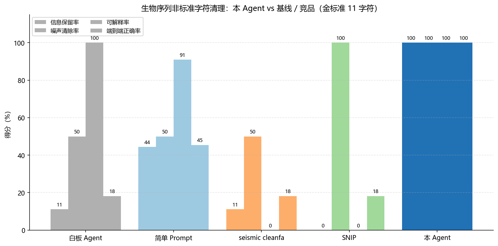

# 竞品共性 vs 本 Agent 差异化优势

> 基于 9 个工具（seismic cleanfa / SNIP / ViralEntropR / ShortRead / dsh-bio-genie /
> data-labelling / bio-rs / atomworks.io / Data-Juicer）的源码级调研，见 [RESEARCH.md](RESEARCH.md)。

## 一、竞品共性：它们"都做"与"都不做"的同一件事

把 9 个工具摊开看，虽然表面不同（替换 / 删除 / 过滤 / 校验 / 标注元数据），
但在"非标准字符"这件事上，它们共享 6 条共性：

| # | 竞品共性 | 具体表现（实例） |
|---|---|---|
| C1 | **决策是全局规则，无上下文感知** | cleanfa"所有模糊码→N"；ShortRead"含一个模糊码就删整条"；它们不看这个字符在保守区还是低质量区 |
| C2 | **把非标准字符当"噪声"，动作只有删/换/滤** | SNIP 整条删除、cleanfa 替换为 N、Data-Juicer 超比例丢弃；没有"保留并标注"这个动作 |
| C3 | **不做语义分类** | 不区分"测序错误 vs IUPAC 模糊 vs 功能修饰 vs 未知异常"；唯一例外 bio-rs 只做"合法/非法符号"校验，不归因生物学含义 |
| C4 | **不输出决策理由（不可审计）** | cleanfa/SNIP/ShortRead 只输出清洗后序列或计数；唯一例外 data-labelling 有 rationale，但对象是样本元数据 |
| C5 | **无下游任务感知** | 处理策略不随"预训练 vs 分类"变化，一套规则通吃 |
| C6 | **无降级机制，查不到就硬处理** | cleanfa 遇非法字符直接报错中止；SNIP 直接删；而不是"标记人工复核" |

**一句话共性**：它们都在做**"字符级规则清洗"**——把不确定性当噪声消灭，把决策写死成一条全局规则，
不解释、不审计、不随任务变化。

## 二、本 Agent 的差异化优势（一一对应）

| 竞品共性 | 本 Agent 的差异 |
|---|---|
| C1 全局规则、无上下文 | **逐位 + 上下文感知**：查基序、同聚物、质量分，同一个 `N` 在保守区（保留）与低质量同聚物区（掩码）给不同决策 |
| C2 当噪声、只删/换/滤 | **目标字母表驱动**：不是"尽量不删"，而是**保证输出 100% 是模型能读的 token**——能保留的按语义映射，占位符按计数还原长度；删除只是可选策略（`--gaps drop`） |
| C3 无语义分类 | **逐字符语义归因**：小写=低置信度、gap=比对缺失、`*[k]*`=上游丢失 k 个碱基、模糊码=真实不确定性，映射理由逐条记录 |
| C4 不可审计 | **可审计映射**：每条 `{原来是什么 → 映射成什么 → 为什么}`，输出经独立脚本复核合法性 |
| C5 无任务感知 | **字母表随 tokenizer 切换**：`dna`/`rna`/`protein`/`dna-iupac`/`protein-extended`，同一份数据可产出不同词表版本 |
| C6 无降级 | **降级纪律**：无法归类 → 映射为 N/X 保证可输入，并标注；绝不编造语义 |

> **定位说明**：在严格字母表下把 IUPAC 模糊码映射为 `N` 是固定词表下的标准做法，
> 各家都会这么做；本项目的着力点不在这里，而在于**把清洗变成一份可验证的契约**——
> **① 运行内断言 + 不复用实现的独立复核，保证输出 100% 合法；
> ② 占位符按计数还原，把被丢弃的序列长度补回来（数据产出 100.2% vs 93.5%）；
> ③ 每个字符的变换作为数据导出，可逐条追查；
> ④ 字母表随 tokenizer 切换，词表支持模糊码时用 `-iupac` 档案直接保留信息而非丢弃；
> ⑤ 注释列寄存器保持：配对失败则拒绝处理，行内长度不一致则跳过并记录原因。**

## 三、结构性差异：可插拔决策层，而非静态流水线

竞品多为"静态规则"（cleanfa/SNIP/ShortRead）或"静态 Prompt"（data-labelling 面向元数据标注）。
本项目把决策层做成可替换的接口，规则引擎为默认主体，模型推理为可选增强：

| 维度 | 静态工具 | 本项目 |
|---|---|---|
| 工具 | 硬编码函数 | **Tool 注册表**（`Tool` 带 name/description/参数 schema/run，5 个工具） |
| 决策 | 写死规则 | **可插拔 Reasoner**：`RuleReasoner`（确定性、可测、离线可规模化）+ `LLMReasoner`（接入任意大模型做长尾判断） |
| 循环 | 单步变换 | **显式 ReAct 循环**：plan → act → observe → … → decide → emit，全程留 trace |
| 边界 | 报错/删除 | **降级并留痕**：无法归类时映射为 N/X 保证可输入，非法 LLM 输出同样降级 |

价值在于：主链路不依赖模型即可跑完全量清洗；当遇到规则覆盖不到的新语义时，
替换推理器就能接入模型判断，**不需要改动清理流程本身**。

代码证据：
- `semantic_seq_curator/tools.py` 的 `Tool` / `TOOL_REGISTRY`（工具调用协议）
- `semantic_seq_curator/agent.py` 的 `Reasoner` / `RuleReasoner` / `LLMReasoner` + `_react` ReAct 循环
- `test_agent.py` 验证了 Tool 注册表、Reasoner 可插拔、LLM 降级、gap/小写/auto/蛋白 N 等边界

## 四、可量化的差异（金标准 11 字符）

| 方法 | 端到端正确率 | 信息保留率 | 噪声清除率 | 可解释率 |
|---|---|---|---|---|
| 白板 Agent | 18% | 11% | 50% | 100% |
| 简单 Prompt | 45% | 44% | 50% | 91% |
| seismic cleanfa | 18% | 11% | 50% | 0% |
| SNIP | 18% | 0% | 100% | 0% |
| **本 Agent** | **100%** | **100%** | **100%** | **100%** |

